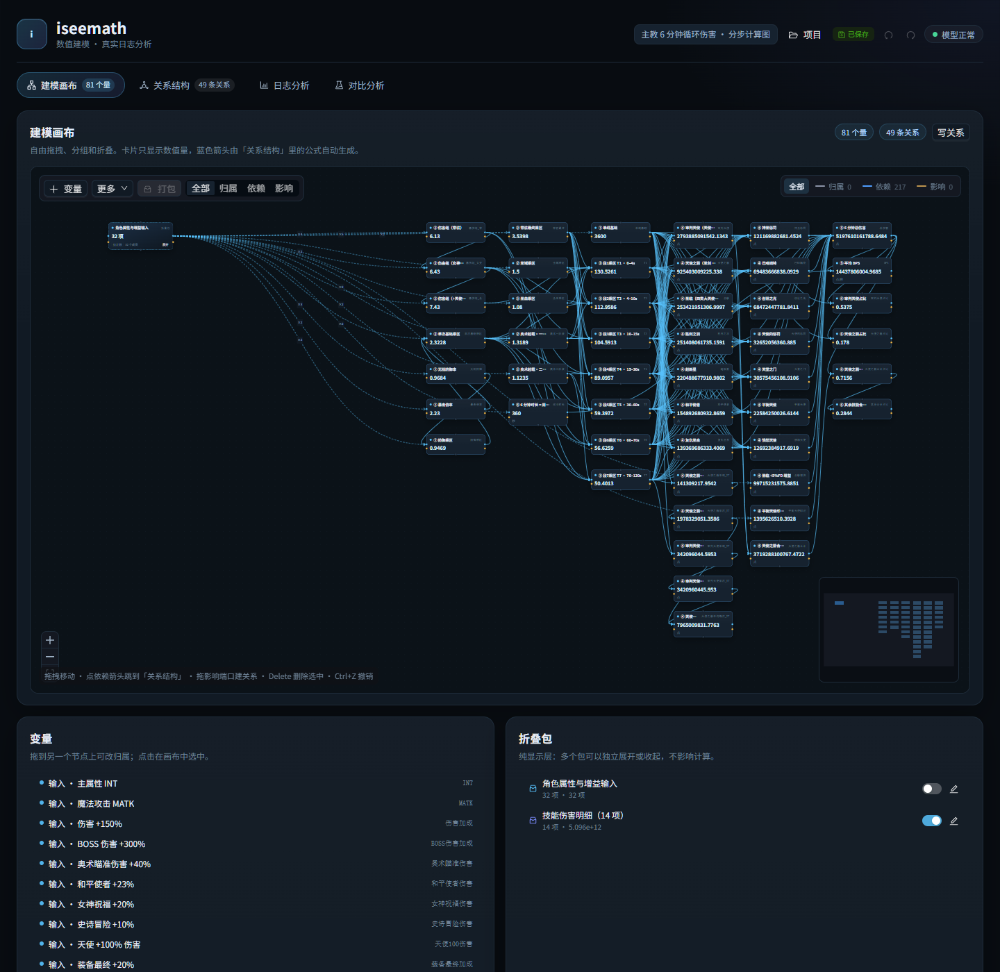

# 示例：主教 6 分钟循环伤害 · 分步计算图

文件：[bishop-6min-graph.project.json](bishop-6min-graph.project.json)

这个项目把冒险岛主教（Bishop）一套 6 分钟（3 × 120 秒）木桩输出的计算，拆成 81 个可以逐个检查的节点：

- **32 个输入常量**：主属性、魔法攻击、各类伤害/最终伤害/无视/暴击，以及两个统计基数；
- **49 个公式节点**：从单线基础、乘区，到 7 个时间段的综合乘区、14 个技能、天使之箭单次伤害，最后汇总；
- **2 个折叠包**：`角色属性与增益输入`（32 项，建议收起）和 `技能伤害明细`（14 项）。

**天堂的诫命不计入**：该技能一场战斗限用 3 次，且已按职业单独平衡，因此从技能伤害、
总伤害和占比中整体排除；项目里没有这个节点。

天使之箭按 **HEXA 版**计算：普通 4 转天使之箭被替换为 `354% × 14` 的圣剑攻击，
并且每 8 次圣剑命中触发一次 `857% × 10` 的审判天使特效；两者都吃 V 节点
`60 级 × 2% = +120% 最终伤害`（即 ×2.2）。数值由同一份外部排程脚本按 HEXA 版重算；
工具本身没有改。



## 1. 导入与阅读

1. 顶栏「项目 → 导入项目 JSON」，选择 `bishop-6min-graph.project.json`。
2. 导入后应看到 **81 个量 / 49 条关系 / 问题 0**。
3. 画布按从左到右的顺序阅读，节点标题前的序号就是计算步骤：

| 列 | 步骤 | 内容 |
|---|---|---|
| 最左 | 输入 | 32 个常量（默认打包为“角色属性与增益输入”） |
| A 列 | ① / ② | 单线基础、无视防御、暴击倍率、防御乘区；三档伤害组、单次基础乘区 |
| B 列 | ② | 常驻最终乘区、圣域/圣血乘区、奥术超载一/二阶段 |
| C 列 | ③ | 单线基础与 7 个时间段的综合乘区 T1–T7 |
| D/E 列 | ④ | 14 个技能伤害、天使之箭与审判天使的单段/单次伤害、圣临增伤、平衡天使印记 |
| F 列 | ⑤ / ⑥ | 总伤害、DPS、占比 |

- 每张卡片显示当前值；公式不在卡片上，而是集中写在「关系结构」标签页。
- 画布上的**蓝色实线**是公式依赖，由公式自动生成；改公式会自动改连线。
- 「关系结构」里每条关系就是一行公式；技能节点的 `段1系数 … 段7系数` 是局部量，只在当前技能内有效，右侧显示实时值。

> 当前导入流程不会立刻应用项目文件里的 `viewState`（折叠包收起状态），
> 所以导入后 32 个输入量仍然摊开在画布上。在右下「折叠包」里把
> 「角色属性与增益输入」的开关关掉，画布会清爽很多；文件里已经写好了收起状态，
> 等工具修复导入顺序后会直接生效。

## 2. 每一步的公式

### ① 基础量

| 节点 | 公式 | 值 |
|---|---|---|
| 单线基础 | `(MATK * 4 + INT) / 100` | 3600 |
| 无视防御 | `1 - (1 - 基础无视)(1 - 正义无视)(1 - 奥术瞄准无视)` | 0.9684 |
| 暴击倍率 | `1 + 暴击基础 + 暴击伤害加成` | 2.23 |
| 防御乘区 | `clamp(1 - 目标防御 × (1 - 无视防御) × (1 - 嗔怒减防), 0.05, 1)` | 0.946912 |

### ② 综合乘区

| 节点 | 公式 / 含义 | 值 |
|---|---|---|
| 基伤组_常 | `1 + 伤害 + BOSS伤害 + 奥术瞄准 + 和平使者` | 6.13 |
| 基伤组_女史 | 常驻组 + 女神祝福 + 史诗冒险（0–60s） | 6.43 |
| 基伤组_全 | 女史组 + 天使 +100%（0–4s） | 7.43 |
| 单次基础乘区 | `暴击倍率 × 防御乘区 × 属性乘区` | 2.322775 |
| 常驻最终 | `(1+装备)(1+无限)(1+正义)(1+和谐)(1+魔力)` | 3.539765 |
| 圣域乘区 / 圣血乘区 | `1 + 圣域FD` / `1 + 圣血FD` | 1.5 / 1.08 |
| 奥术一阶段 | `(1+超载FD1)(1+超载MATK1)` | 1.3189 |
| 奥术二阶段 | `(1+超载FD2)(1+超载MATK2)` | 1.1235 |

### ③ 7 个时间段

每个 T 都是「伤害组 × 单次基础乘区 × 常驻最终 × 当时生效的 buff 乘区」：

| 段 | 时间窗 | 使用的组与 buff | 乘区值 |
|---|---|---|---|
| T1 | 0–4s | 全组 + 圣域 + 圣血 + 奥术一 | 130.5261 |
| T2 | 4–10s | 女史组 + 圣域 + 圣血 + 奥术一 | 112.9586 |
| T3 | 10–15s | 女史组 + 圣域 + 奥术一 | 104.5913 |
| T4 | 15–30s | 女史组 + 圣域 + 奥术二 | 89.0957 |
| T5 | 30–60s | 女史组 + 奥术二 | 59.3972 |
| T6 | 60–70s | 常驻组 + 奥术二 | 56.6259 |
| T7 | 70–120s | 常驻组 | 50.4013 |

### ④ 技能伤害

14 个技能使用同一种结构：

```text
let 段1系数 = …; … let 段7系数 = …;
单线基础 * (段1系数 * T1 + … + 段7系数 * T7)
```

段系数 = 该技能在这个时间窗里的「技能倍率 × 命中次数」累计，**已经包含 3 个周期**，
所以不需要在图里再循环 3 次。前三个技能：

| 技能 | 段系数（T1…T7） | 6 分钟伤害 |
|---|---|---|
| 审判天使（天使之箭特效） | 56562 / 56562 / 395934 / 1753422 / 3676530 / 980408 / 5769324 | 2,793,885,091,542 |
| 天使之箭（圣剑直伤） | 21806.4 / 21806.4 / 130838.4 / 577869.6 / 1210255.2 / 327096 / 1908060 | 925,403,009,225 |
| 圣临（四类大天使合计） | 342685.68 / 37205.94 / 21808.53 / 88527.05 / 169360.73 / 21808.53 / 0 | 253,421,951,307 |

另外两个增益节点：

- 圣临增伤 = `圣临增伤基数 × 0.05` = 99,715,231,576
- 平衡天使印记 = `平衡印记基数 × 0.10` = 1,395,626,510

#### 天使之箭的“单次伤害”

HEXA 天使之箭由两部分组成：

```text
圣剑直伤：354% × 14 段
特效审判天使：每 8 次圣剑命中触发 1 次，857% × 10 段
V 节点强化：60 级 × 2% = +120% 最终伤害，即 ×2.2
```

354% = 334% 基础 + HEXA 巴哈姆特被动 20 点；
857% = 822% 基础 + HEXA 巴哈姆特被动 35 点；触发门槛 8 次 = 12 − 4。
按单段展开：

```text
圣剑单段 = 单线基础 × 354 × 2.2 × 当前段乘区
审判单段 = 单线基础 × 857 × 2.2 × 当前段乘区

一次施放（圣剑）= 圣剑单段 × 14
一次特效（审判）= 审判单段 × 10，每 8 次圣剑命中触发
平均每次施放 = 圣剑单段 × 14 + 审判单段 × 10 × (14 / 8)
```

以 T3（10–15s：女史组 + 圣域 + 奥术一阶段）为例：

```text
3600 × 354 × 2.2
× 6.43                 ← 伤害组（1+150%+300%+40%+23%+20%+10%）
× 2.23                 ← 暴击倍率（1+35%+88%）
× 0.946912             ← 防御乘区
× 1.10                 ← 属性乘区
× 3.539765             ← 常驻最终
× 1.5                  ← 圣域
× 1.3189               ← 奥术一阶段（1.21 × 1.09）
= 293,240,613 / 段（圣剑）
= 4,105,368,581 / 次施放（14 段）
```

同一时间窗下，特效的 1 段为 709,907,360，1 次触发（10 段）为 7,099,073,596；
平均到每次施放（1.75 次触发）合计 **16,528,747,374**。

各时间窗的单段/单次伤害：

| 段 | 当前乘区 | 圣剑单段 | 圣剑单次（14 段） | 审判单段 | 审判单次（10 段） | 平均每次施放（含特效） |
|---|---:|---:|---:|---:|---:|---:|
| T1 | 130.5261 | 365,953,340 | 5,123,346,756 | 885,937,887 | 8,859,378,874 | 20,627,259,786 |
| T2 | 112.9586 | 316,699,862 | 4,433,798,068 | 766,699,948 | 7,666,999,483 | 17,851,047,164 |
| T3 | 104.5913 | 293,240,613 | 4,105,368,581 | 709,907,360 | 7,099,073,596 | 16,528,747,374 |
| T4 | 89.0957 | 249,795,912 | 3,497,142,771 | 604,731,912 | 6,047,319,118 | 14,079,951,228 |
| T5 | 59.3972 | 166,530,608 | 2,331,428,514 | 403,154,608 | 4,031,546,079 | 9,386,634,152 |
| T6 | 56.6259 | 158,760,906 | 2,222,652,689 | 384,344,906 | 3,843,449,061 | 8,948,688,546 |
| T7 | 50.4013 | 141,309,218 | 1,978,329,051 | 342,096,045 | 3,420,960,446 | 7,965,009,832 |

6 分钟口径：385 次施放、5,390 次圣剑命中、673 次审判天使触发。
圣剑直伤合计 925.4 B，审判天使合计 2,793.9 B，两者合计 **3,719.3 B（71.56%）**。
**不要把 3,719.3 B 当成“单次伤害”**；它和表里的单段/单次数值是不同口径。

如果游戏内实测和这里差得多，按下面几项对照：

- **是否把特效算进去了**：审判天使的伤害约为圣剑直伤的 3 倍；只对比圣剑 14 段会漏掉大部分输出。
- **时间窗**：T1 与 T7 的单段相差 2.6 倍；先说清楚这一下是在 0–4s 还是 70–120s。
- **暴击**：模型按 100% 暴击的期望值（×2.23）计算；实测非暴击单段约为表中的 1/2.23。
- **属性基线**：模型固定 INT 120,000 / MATK 60,000，单段与 `(MATK×4+INT)/100` 成正比。
- **强化倍率**：2.2× 按 60 级 × 2% 计算；若 V 节点等级不同，改技能节点里的 2.2。
- **巴哈姆特被动**：354% / 857% 已含 HEXA 巴哈姆特满级被动的 +20 / +35 点；没有 HEXA 巴哈姆特时会低一截。
- **目标与减防**：模型假设 300% 防御、96.84% 无视、愤怒天使 -44% 防御，防御乘区 0.946912。
- **技能倍率版本**：334% / 822% / 12 次来自 wiki；如果当前版本数值不同，替换对应数字。

### ⑤ / ⑥ 汇总

| 节点 | 公式 | 值 |
|---|---|---|
| 总伤害 | 14 个技能 + 圣临增伤 + 印记 | 5,197,610,161,788.648 |
| DPS | `总伤害 / 战斗时长`，时长 = 120 × 3 | 14,437,806,004.968 |
| 审判天使占比 | `审判天使 / 总伤害` | 0.5375 |
| 天使之箭占比 | `天使之箭 / 总伤害` | 0.1780 |
| 天使之箭合计占比 | `(天使之箭 + 审判天使) / 总伤害` | 0.7156 |
| 其余合计占比 | `1 - 天使之箭合计占比` | 0.2844 |

完整占比（扣除天堂的诫命，HEXA 天使之箭口径）：

| 技能 | 伤害 | 占比 |
|---|---:|---:|
| 审判天使（天使之箭特效） | 2,793,885,091,542 | 53.75% |
| 天使之箭（圣剑直伤） | 925,403,009,225 | 17.80% |
| 圣临（四类大天使合计） | 253,421,951,307 | 4.88% |
| 胜利之羽 | 251,408,061,735 | 4.84% |
| 超新星 | 220,488,677,911 | 4.24% |
| 和平使者 | 154,892,680,933 | 2.98% |
| 复仇圣泉 | 139,369,686,333 | 2.68% |
| 神圣惩罚 | 121,169,882,681 | 2.33% |
| 巴哈姆特 | 69,483,666,838 | 1.34% |
| 创世之光 | 68,472,447,782 | 1.32% |
| 天使的惩罚 | 32,652,056,361 | 0.63% |
| 天堂之门 | 30,575,456,109 | 0.59% |
| 平衡天使 | 22,584,250,027 | 0.43% |
| 愤怒天使 | 12,692,384,918 | 0.24% |
| 圣临增伤（+5% FD） | 99,715,231,576 | 1.92% |
| 平衡天使印记（+10%） | 1,395,626,510 | 0.03% |

## 3. 改参数与复用

- 展开「角色属性与增益输入」折叠包，或从左下变量列表选中输入量，在右侧检查器改值；
  所有下游节点会立即重算，不需要改公式。
- 想换一套装备/属性，直接改这些常量即可；想换技能排程，改技能节点里的 `段1系数…段7系数`。
- 想检查某个数字是怎么来的：点该卡片 → 看「关系结构」里对应的一行公式；
  或直接把画布缩放到对应列，蓝色箭头就是它的全部输入。
- 需要重新导出时用「项目 → 导出项目 JSON」；导出会带上当前折叠状态。

## 4. 已知限制

- **导入不应用 `viewState`**：折叠包的默认收起状态在导入后不会生效，需要手动切换一次开关。
  这是工具当前导入流程的问题，已记录；项目文件本身是正确的。
- **边很多**：14 个技能都要引用 7 个时间段，画布上有约 220 条依赖边。建议先收起输入包，
  再放大查看技能与时间段的连接；依赖边本身不能删，改公式才会变。
- **静态模型**：这里只还原数值与时间窗，不包含战斗日志、随机数或逐次事件的模拟。
